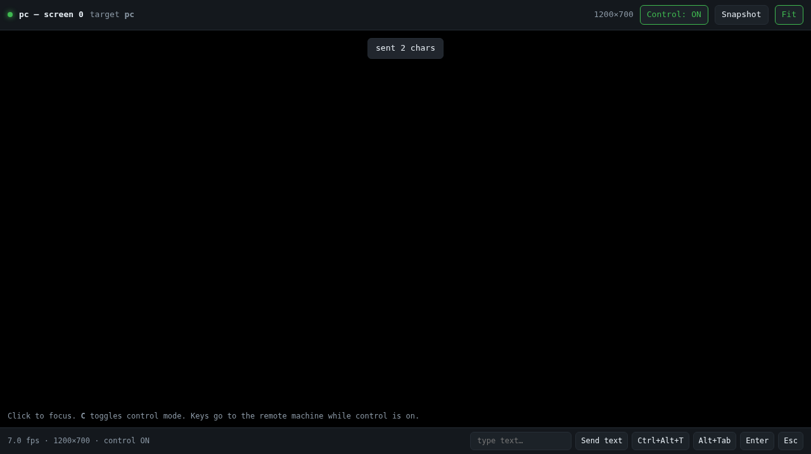

# Reaven

Server-relayed remote administration: a shell, file transfer, **screenshots**,
**live screen streaming with mouse/keyboard control**, and **webcam viewing** —
driven from a desktop CLI, a browser, or the included **Android app**.

Upstream Reaven was a small Rust prototype for a relayed shell. This version keeps
that and adds the remote-desktop half, plus an operator app for phones.

```
      ┌──────────┐        ┌───────────────┐        ┌───────────────┐
      │  phone   │◀──────▶│  relay        │◀──────▶│  agent (PC)   │
      │  app     │  TCP   │  reaven server│  TCP   │ reaven connect│
      └──────────┘        └───────────────┘        └───────────────┘
                                    ▲                       ▲
                                    │                       │
                              ┌─────┴──────┐        ┌───────┴────────┐
                              │ CLI / web  │        │ screen · webcam│
                              │  operator  │        │ mouse · keyboard│
                              └────────────┘        └────────────────┘
```

The relay routes frames by peer name; pixels and input never terminate there.

---

## Build

```bash
cargo build --release
sudo install -m 0755 target/release/reaven /usr/local/bin/reaven
```

### System packages

| Feature | Build-time packages | Runtime packages |
|---|---|---|
| relay, shell, files | — | **none** |
| `screen` (capture) | — | **none** (talks to the X server directly) |
| `input` (injection) | — | **none** |
| `webcam` | `libclang-dev` (v4l2 bindgen) | **none** |

Nothing links against `libxcb`, `libX11`, `libdbus`, `libxdo` or `libv4l` — see
"Using it without building" below for why that matters.

### Fully static build

```bash
rustup target add x86_64-unknown-linux-musl
cargo build --release --target x86_64-unknown-linux-musl   # ~3.9 MB, zero deps
```

Feature flags are independent:

```bash
cargo build --no-default-features --features screen,input   # no webcam
cargo build --no-default-features                            # relay-only
```

### Using it without building

A single prebuilt binary is in [`artifacts/`](artifacts/):
`reaven-0.2.0-linux-x86_64`, 3.9 MB, **statically linked**.

```bash
chmod +x artifacts/reaven-0.2.0-linux-x86_64
./artifacts/reaven-0.2.0-linux-x86_64 server --listen 0.0.0.0:7331 --password 'secret'
```

**No packages to install, and no library can be missing.** It is not linked
against `libxcb`, `libX11`, `libdbus`, `libxdo` or `libv4l`, and it does not
depend on a particular glibc version, so it runs as-is on Debian, Ubuntu, Fedora,
RHEL, Alpine, or a bare container. Details: [docs/RUNTIME.md](docs/RUNTIME.md).

**Command-line use never requires X11.** The relay, `exec`, `cl`, upload and
download run on a headless server with no display and no X libraries installed.
Commands that genuinely need a screen (`screenshot`, `screen`, `webcam`) fail with
a sentence telling you what is missing, instead of preventing the binary from
starting.

**Platform support:** Linux/X11 is what the test suite runs against and is the
only combination verified end-to-end. Windows and macOS compile through the same
`enigo`/`nokhwa` backends but are **untested here** — treat them as experimental.

**Wayland:** capture and control go through XWayland, so they work for X11
applications, which is most of them, but a native Wayland window may not appear
in the capture and cannot be clicked. For native-Wayland capture you would need a
`xdg-desktop-portal`/PipeWire backend, which this build does not include (it is
what previously dragged in `libdbus`/`libxcb`).

---

## Quick start

**1. Relay** — one machine, reachable by all the others:

```bash
reaven server --listen 0.0.0.0:7331 --password 'use-a-long-random-secret'
```

**2. Agent** — on each machine you want to reach:

```bash
reaven connect --server your-server.example:7331 --name desktop --password 'use-a-long-random-secret'
```

Add `--no-input` to make that machine **view-only** (screenshots and streaming
still work; mouse and keyboard are refused).

**3. Operator** — see what is online, then grab a screen:

```bash
reaven peers --server your-server.example:7331
reaven screenshot --server your-server.example:7331 --target desktop --output desk.jpg
reaven screen --server your-server.example:7331 --target desktop
```

`reaven screen` prints a URL. Open `http://127.0.0.1:8080/` and you get a live
view you can click and type into.

Set `REAVEN_PASSWORD` instead of repeating `--password`.

### What it looks like



The browser viewer: live MJPEG of the remote desktop at 1200×700 with control
enabled. This image was captured by `tests/viewer_browser_check.py` driving a real
headless Chromium against a live relay and agent — it is a screenshot of the
actual viewer, not a mockup.

---

## Commands

Everything from the original tool still works:

```bash
reaven cl       --server HOST --target NAME                      # full interactive PTY shell
reaven exec     --server HOST --target NAME --command 'uname -a'
reaven upload   --server HOST --target NAME ./local.txt /tmp/local.txt
reaven download --server HOST --target NAME /var/log/syslog ./syslog
reaven install-autostart --server HOST --name NAME [--no-input]
```

### Discovery

```bash
reaven peers   --server HOST                  # machines currently online
reaven screens --server HOST --target NAME    # monitors: index, size, position, scale
reaven cameras --server HOST --target NAME    # webcams by index and name
```

### Screenshots

```bash
reaven screenshot --server HOST --target NAME --output shot.jpg \
                  [--monitor 0] [--quality 85] [--max-width 1920]
```

Writes a JPEG locally and prints the dimensions. `--monitor` indexes the list from
`reaven screens`; `--max-width` down-scales.

### Live screen with control

```bash
reaven screen --server HOST --target NAME \
              [--monitor 0] [--fps 12] [--quality 70] [--max-width 1600] \
              [--bind 127.0.0.1:8080] [--no-viewer] [--view-only] \
              [--record frames/] [--duration 30]
```

- Serves an MJPEG viewer at `--bind`. The viewer sends clicks, drags, wheel
  events and keystrokes back to the agent.
- `--view-only` gives a viewer that cannot inject input.
- `--no-viewer` streams without the HTTP server (useful with `--record` or for
  headless checks).
- `--record DIR` writes every frame as `frame_NNNNNN.jpg`.

Browse to a **phone on the same LAN** by binding wider:

```bash
reaven screen --server HOST --target desktop --bind 0.0.0.0:8080
# then open http://<your-pc-ip>:8080/ on the phone
```

The viewer warns loudly when it is bound beyond loopback, because anyone who can
open that URL can drive the machine.

**Viewer controls:** click to focus, then mouse clicks/drags/wheel map straight
through. `C` toggles control mode, **Snapshot** downloads the current frame,
**Fit/Actual** zooms, and the footer has a text box plus `Ctrl+Alt+T`, `Alt+Tab`,
`Enter` and `Esc` shortcuts. Touch works too: one-finger drag moves the pointer,
tap clicks, two-finger drag scrolls.

### Webcam

```bash
reaven webcam --server HOST --target NAME --index 0                  # live view
reaven webcam --server HOST --target NAME --snapshot face.jpg        # one frame
reaven webcam --server HOST --target NAME --bind 127.0.0.1:8081 --fps 10
```

No input mapping is offered on a webcam stream — a camera frame has no desktop
geometry to map pointer coordinates onto.

### Direct input injection

```bash
reaven input --server HOST --target NAME --at 0.5,0.5 --click left
reaven input --server HOST --target NAME --at 0.1,0.1 --click right --double
reaven input --server HOST --target NAME --scroll -3
reaven input --server HOST --target NAME --key Return
reaven input --server HOST --target NAME --text 'hello world'
reaven input --server HOST --target NAME --combo ctrl+alt+t
```

`--at` takes **normalised** coordinates (`0.0`–`1.0`) relative to the most recent
screen stream, so it is resolution-independent. Start a stream first — the agent
needs the stream's geometry to map coordinates onto pixels.

---

## Android app

A Kotlin/Compose operator console in [`android/`](android/). The phone is the
**controller**: it holds no agent, runs nothing in the background, and only ever
makes the same operator connection the CLI does.

A prebuilt debug APK is at **`android/artifacts/reaven-control-0.2.0-debug.apk`**
(16 MB, `minSdk` 26 / Android 8.0+, `targetSdk` 34). Install with:

```bash
adb install android/artifacts/reaven-control-0.2.0-debug.apk
```

**Build it yourself:**

```bash
cd android
./gradlew assembleDebug          # or: open the folder in Android Studio
adb install app/build/outputs/apk/debug/app-debug.apk
```

*(No Gradle wrapper is committed — run `gradle wrapper` once, or just open the
project in Android Studio, which supplies it.)*

### What it does

| Screen | Capability |
|---|---|
| **Connect** | Relay host/port/password, remembers them between launches |
| **Machines** | Live device list, polls every 3 s, shows hostname/OS/version |
| **Screen** | Live JPEG stream; tap = click, press-and-hold = right click, drag = press/move/release; ▲▼ wheel buttons; Enter/Esc/Tab/Ctrl+C/Alt+Tab/Win keys; text box for typing; **Snapshot** saves to the photo gallery; adjustable quality and fps |
| **Console** | Command input with presets (`uname -a`, `uptime`, `df -h`, …), scrollback |
| **Camera** | Lists remote webcams, live view, single-frame capture to the gallery |

Coordinates are normalised to the decoded frame, so phone and desktop aspect
ratios never have to match. The Console tab uses one-shot `exec` per command
rather than a raw PTY — ANSI escapes render badly on a phone, and for a real
terminal `reaven cl` on a desktop is the better tool.

Cleartext TCP is permitted (`usesCleartextTraffic`), since the relay has no TLS.
See the security section before using this outside a trusted network.

---

## Security model — read this

This is a **prototype**, not a hardened tool. Upstream's warnings still apply, and
the new features make them matter more.

- **Transport is plain TCP.** Passwords, keystrokes, screen contents and webcam
  frames are unencrypted and unauthenticated. Run it over WireGuard/Tailscale/SSH
  or on a trusted LAN, and firewall the relay port.
- **One shared password.** No per-device keys, no per-user authorisation, no
  audit trail, no command sandbox. Anyone with the password can drive every
  agent on that relay.
- **The relay can see and modify traffic.** It is a trusted component: it routes
  frames, so it could observe or alter them.
- **The relay has a no-password mode.** Never expose that to a network.
- **Remote control is powerful.** An operator can move the pointer, type into
  password prompts, and read anything on screen. Use `--no-input` for view-only
  agents, and `--view-only` for viewers you hand to someone else.
- **The agent announces control sessions on its own console** — stream start/stop,
  shell opens, and rejected input all print locally, so the machine's owner has a
  record. It is a log line, not a system tray indicator; do not treat it as a
  security control.
- **Nothing is drawn on the watched screen.** No banner, border, tray icon or
  animation appears when another device views it: capture is a bare framebuffer
  read and the agent creates no window, and the e2e suite asserts the watched
  desktop stays pixel-identical during a stream. Detection rests on the console
  log and `ps`, above — not on anything visual.
- **The Android app stores the relay password in plain SharedPreferences.**
  Acceptable for a LAN-only relay; not for a shared phone.
- **No TLS, no audio, no clipboard sync, no file-transfer UI in the app.**

Only run agents on machines you own or administer, with the knowledge of whoever
uses them.

---

## Testing

```bash
./tests/run_all.sh               # everything below, with a pass/fail summary

cargo test                       # protocol, coordinate mapping, HTTP/input parsing (10 tests)
./tests/e2e.sh                   # 25 end-to-end checks against a real Xvfb display
xvfb-run -a tests/android_client_sim.py ./target/debug/reaven
python3 tests/viewer_browser_check.py http://127.0.0.1:8080/   # needs chromium
```

`tests/e2e.sh` spins up a relay, an agent and an Xvfb display, then verifies
screenshots (valid JPEG, correct down-scale), live streaming (frame count,
recording), pixel-exact pointer placement for both CLI and HTTP-driven clicks,
view-only refusal, auth rejection and offline-target errors.

`tests/android_client_sim.py` speaks the **exact JSON the Android app emits**
(see `android/.../data/Protocol.kt`) against a live relay+agent, so the mobile
client's wire format is verified without an emulator.

`tests/viewer_browser_check.py` drives headless Chromium over the DevTools
Protocol: it asserts that frames decode, the fps readout is live, control mode
toggles, and that a browser click lands on the remote pointer to within a couple
of pixels. This is the check that caught two real viewer bugs (per-part `load`
events not firing for MJPEG, and a byte-comparison error in the multipart parser).

```
All end-to-end checks passed
Android client protocol simulation: all checks passed
Viewer browser check: all passed
```

---

## Layout

```
src/protocol.rs   wire format: Frame, Operation, Payload, InputEvent, framing
src/relay.rs      relay: auth, peer registry, frame routing
src/agent.rs      agent: exec, files, PTY shells, video streams, input injection
src/operator.rs   CLI client: shell, one-shots, streaming, input
src/desktop.rs    capture + injection backends (feature-gated per capability)
src/httpd.rs      tiny HTTP server for the live viewer
src/viewer.html   the viewer page (inline CSS/JS, no external assets)
android/          Kotlin/Compose operator app (+ prebuilt debug APK)
docs/PROTOCOL.md  frame reference
docs/ANDROID.md   app architecture, verified toolchain, limitations
docs/RUNTIME.md   runtime requirements (what to install to *use* it)
artifacts/        prebuilt binary (static, zero runtime deps)
scripts/demo.sh   runs the whole stack locally on a virtual display
tests/            unit, end-to-end, protocol-simulation and browser checks
```

## Licence

MIT, as upstream. See [LICENSE](LICENSE).
