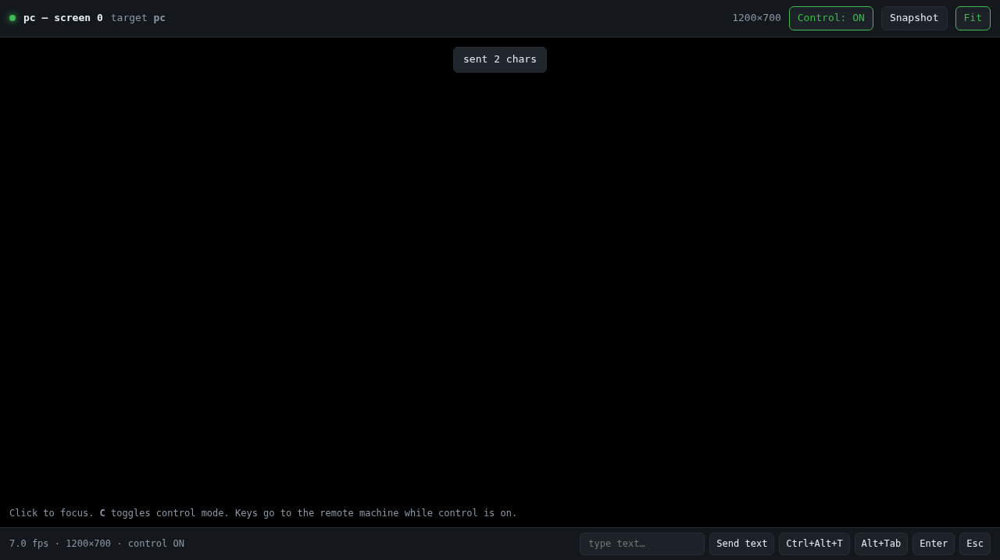

# Reaven

Server-relayed remote administration: a shell, file transfer, **screenshots**,
**live screen streaming with mouse/keyboard control**, and **webcam viewing** —
driven from a desktop CLI, a browser, or the included **Android app**.

Upstream Reaven was a small Rust prototype for a relayed shell. This version keeps
that and adds the remote-desktop half, an operator app for phones, and a secure
**WSS** transport with automatic Let's Encrypt certificates.

```
      ┌──────────┐        ┌───────────────┐        ┌───────────────┐
      │  phone   │◀──────▶│  relay        │◀──────▶│  agent (PC)   │
      │  app     │  WSS   │  reaven server│  WSS   │ reaven connect│
      └──────────┘ :443   └───────────────┘  443   └───────────────┘
                                    ▲                       ▲
                                    │                       │
                              ┌─────┴──────┐        ┌───────┴────────┐
                              │ CLI / web  │        │ screen · webcam│
                              │  operator  │        │ mouse · keyboard│
                              └────────────┘        └────────────────┘
```

Every peer connects with a standard TLS-protected WebSocket
(`wss://relay.example/ws`). The relay routes frames by peer name; pixels and
input never terminate there. There is **no plaintext listener**: the relay always
serves TLS, and agents/operators always verify the certificate unless explicitly
told not to.

---

## Secure transport

The relay speaks **WSS** on port 443. Pick one TLS mode, in this priority order:

| Mode | Server flags | Use it for |
|---|---|---|
| **ACME / Let's Encrypt** | `--acme-domain relay.example.com [--acme-email you@example.com]` | a public relay with a real domain |
| **Existing certificate** | `--tls-cert fullchain.pem --tls-key privkey.pem` | a certificate you already manage |
| **Self-signed** | `--self-signed` | local testing only |

Automatic certificates use **TLS-ALPN-01**, so no separate HTTP challenge server
is needed: validation and the relay both use TCP 443. Requirements:

- the domain's DNS `A`/`AAAA` record points at the relay;
- TCP 443 is reachable from the public internet (directly, or forwarded to
  `--listen` if you use another port);
- the ACME cache (`~/.reaven/acme` by default) persists between restarts so
  renewals do not re-register the account.

```bash
# Public relay: certificate is obtained and renewed automatically.
sudo reaven server \
  --acme-domain relay.example.com \
  --acme-email you@example.com \
  --password 'use-a-long-random-secret'

# Local test relay: throwaway certificate, clients must pass --insecure.
reaven server --listen 127.0.0.1:17443 --self-signed --password 'test-secret'
```

Client addresses are forgiving. `--server relay.example.com` becomes
`wss://relay.example.com/ws` (port 443); `host:port`, `https://…` and a full
`wss://…/ws` URL also work. Pass the global `--insecure` flag (or set
`REAVEN_INSECURE=true`) only for a self-signed/local relay — it skips certificate
and hostname validation:

```bash
REAVEN_INSECURE=true reaven peers --server 127.0.0.1:17443
```

Without `--insecure`, the client uses the built-in WebPKI roots and rejects
self-signed, expired, mismatched or otherwise untrusted certificates.

---

## Build

```bash
cargo build --release
sudo install -m 0755 target/release/reaven /usr/local/bin/reaven
```

### System packages

| Feature | Build-time packages | Runtime packages |
|---|---|---|
| relay, shell, files, WSS/TLS | a C compiler (for `ring`'s crypto assembly) | **none** |
| `screen` (capture) | — | **none** (talks to the X server directly) |
| `input` (injection) | — | **none** |
| `webcam` | `libclang-dev` (v4l2 bindgen) | **none** |

Nothing links against `libxcb`, `libX11`, `libdbus`, `libxdo` or `libv4l` — see
[docs/RUNTIME.md](docs/RUNTIME.md) for why that matters.

### Fully static build

```bash
rustup target add x86_64-unknown-linux-musl
cargo build --release --target x86_64-unknown-linux-musl   # zero runtime deps
```

Feature flags are independent:

```bash
cargo build --no-default-features --features screen,input   # no webcam
cargo build --no-default-features                            # relay-only
```

### Prebuilt binaries

The checked-in [`artifacts/reaven-0.2.0-linux-x86_64`](artifacts/) predates the
WSS transport: it still speaks the old plaintext TCP protocol and does not accept
the TLS flags. **Build from source (above) for anything that touches a network.**
The old binary is kept only for reproducing the 0.2.0 results.

A source build with the `x86_64-unknown-linux-musl` target is statically linked —
**no packages to install, and no library can be missing.** It is not linked
against `libxcb`, `libX11`, `libdbus`, `libxdo` or `libv4l`, and it does not
depend on a particular glibc version, so it runs as-is on Debian, Ubuntu, Fedora,
RHEL, Alpine, or a bare container. TLS comes from `rustls`/`ring`, not OpenSSL, so
the secure transport adds no shared-library requirement either. Details:
[docs/RUNTIME.md](docs/RUNTIME.md).

**Command-line use never requires X11.** The relay, `exec`, `cl`, upload and
download run on a headless server with no display and no X libraries installed.
Commands that genuinely need a screen (`screenshot`, `screen`, `webcam`) fail with
a sentence telling you what is missing, instead of preventing the binary from
starting.

**Platform support:** Linux/X11 is what the test suite runs against and is the
only combination verified end-to-end. Windows and macOS compile through the same
`enigo`/`nokhwa` backends but are **untested here** — treat them as experimental.

**Wayland:** capture and control go through XWayland, so they work for X11
applications, which is most of them, but a native Wayland window may not appear
in the capture and cannot be clicked. For native-Wayland capture you would need a
`xdg-desktop-portal`/PipeWire backend, which this build does not include (it is
what previously dragged in `libdbus`/`libxcb`).

---

## Quick start

**1. Relay** — one machine with a public DNS name pointing at it:

```bash
# Defaults to 0.0.0.0:443 and obtains/renews the certificate automatically.
sudo reaven server \
  --acme-domain relay.example.com \
  --acme-email you@example.com \
  --password 'use-a-long-random-secret'
```

Port 443 needs root or `CAP_NET_BIND_SERVICE`. If 443 is taken, listen on another
port and forward external 443 to it; ACME validation always uses 443.

**2. Agent** — on each machine you want to reach:

```bash
reaven connect --server relay.example.com --name desktop --password 'use-a-long-random-secret'
```

`host` is upgraded to `wss://host/ws`; port 443 is the default. Add `--no-input`
to make that machine **view-only** (screenshots and streaming still work; mouse
and keyboard are refused).

**3. Operator** — see what is online, then grab a screen:

```bash
reaven peers --server relay.example.com
reaven screenshot --server relay.example.com --target desktop --output desk.jpg
reaven screen --server relay.example.com --target desktop
```

`reaven screen` prints a URL. Open `http://127.0.0.1:8080/` and you get a live
view you can click and type into. This viewer is a separate loopback HTTP server;
it is not the peer transport.

Set `REAVEN_PASSWORD` instead of repeating `--password`.

### What it looks like



The browser viewer: live MJPEG of the remote desktop at 1200×700 with control
enabled. This image was captured by `tests/viewer_browser_check.py` driving a real
headless Chromium against a live relay and agent — it is a screenshot of the
actual viewer, not a mockup.

---

## Commands

Everything from the original tool still works:

```bash
reaven cl       --server HOST --target NAME                      # full interactive PTY shell
reaven exec     --server HOST --target NAME --command 'uname -a'
reaven upload   --server HOST --target NAME ./local.txt /tmp/local.txt
reaven download --server HOST --target NAME /var/log/syslog ./syslog
reaven install-autostart --server HOST --name NAME [--no-input]
```

`HOST` may be a bare hostname (port 443 and `wss://HOST/ws` are inferred),
`host:port`, or a full `wss://HOST/ws` URL. Add the global `--insecure` flag for a
self-signed local relay. `install-autostart` records the flag in `.bashrc` if it
was used.

### Discovery

```bash
reaven peers   --server HOST                  # machines currently online
reaven screens --server HOST --target NAME    # monitors: index, size, position, scale
reaven cameras --server HOST --target NAME    # webcams by index and name
```

### Screenshots

```bash
reaven screenshot --server HOST --target NAME --output shot.jpg \
                  [--monitor 0] [--quality 85] [--max-width 1920]
```

Writes a JPEG locally and prints the dimensions. `--monitor` indexes the list from
`reaven screens`; `--max-width` down-scales.

### Live screen with control

```bash
reaven screen --server HOST --target NAME \
              [--monitor 0] [--fps 12] [--quality 70] [--max-width 1600] \
              [--bind 127.0.0.1:8080] [--no-viewer] [--view-only] \
              [--record frames/] [--duration 30]
```

- Serves an MJPEG viewer at `--bind`. The viewer sends clicks, drags, wheel
  events and keystrokes back to the agent.
- `--view-only` gives a viewer that cannot inject input.
- `--no-viewer` streams without the HTTP server (useful with `--record` or for
  headless checks).
- `--record DIR` writes every frame as `frame_NNNNNN.jpg`.

Browse to a **phone on the same LAN** by binding wider:

```bash
reaven screen --server HOST --target desktop --bind 0.0.0.0:8080
# then open http://<your-pc-ip>:8080/ on the phone
```

The viewer warns loudly when it is bound beyond loopback, because anyone who can
open that URL can drive the machine.

**Viewer controls:** click to focus, then mouse clicks/drags/wheel map straight
through. `C` toggles control mode, **Snapshot** downloads the current frame,
**Fit/Actual** zooms, and the footer has a text box plus `Ctrl+Alt+T`, `Alt+Tab`,
`Enter` and `Esc` shortcuts. Touch works too: one-finger drag moves the pointer,
tap clicks, two-finger drag scrolls.

### Webcam

```bash
reaven webcam --server HOST --target NAME --index 0                  # live view
reaven webcam --server HOST --target NAME --snapshot face.jpg        # one frame
reaven webcam --server HOST --target NAME --bind 127.0.0.1:8081 --fps 10
```

No input mapping is offered on a webcam stream — a camera frame has no desktop
geometry to map pointer coordinates onto.

### Direct input injection

```bash
reaven input --server HOST --target NAME --at 0.5,0.5 --click left
reaven input --server HOST --target NAME --at 0.1,0.1 --click right --double
reaven input --server HOST --target NAME --scroll -3
reaven input --server HOST --target NAME --key Return
reaven input --server HOST --target NAME --text 'hello world'
reaven input --server HOST --target NAME --combo ctrl+alt+t
```

`--at` takes **normalised** coordinates (`0.0`–`1.0`) relative to the most recent
screen stream, so it is resolution-independent. Start a stream first — the agent
needs the stream's geometry to map coordinates onto pixels.

---

## Android app

A Kotlin/Compose operator console in [`android/`](android/). The phone is the
**controller**: it holds no agent, runs nothing in the background, and only ever
makes the same operator connection the CLI does.

The checked-in debug APK at
**`android/artifacts/reaven-control-0.2.0-debug.apk`** (16 MB, `minSdk` 26 /
Android 8.0+, `targetSdk` 34) **predates the WSS client** and still speaks
plaintext TCP. Build the current app from source to connect to a TLS relay.

**Build it yourself:**

```bash
cd android
./gradlew assembleDebug          # or: open the folder in Android Studio
adb install app/build/outputs/apk/debug/app-debug.apk
```

*(No Gradle wrapper is committed — run `gradle wrapper` once, or just open the
project in Android Studio, which supplies it. The client needs OkHttp 4.12.0,
which Gradle fetches automatically.)*

### What it does

| Screen | Capability |
|---|---|
| **Connect** | Relay host/port (default **443**), password, **Allow self-signed certificate** switch; remembers them between launches |
| **Machines** | Live device list, polls every 3 s, shows hostname/OS/version |
| **Screen** | Live JPEG stream; tap = click, press-and-hold = right click, drag = press/move/release; ▲▼ wheel buttons; Enter/Esc/Tab/Ctrl+C/Alt+Tab/Win keys; text box for typing; **Snapshot** saves to the photo gallery; adjustable quality and fps |
| **Console** | Command input with presets (`uname -a`, `uptime`, `df -h`, …), scrollback |
| **Camera** | Lists remote webcams, live view, single-frame capture to the gallery |

Coordinates are normalised to the decoded frame, so phone and desktop aspect
ratios never have to match. The Console tab uses one-shot `exec` per command
rather than a raw PTY — ANSI escapes render badly on a phone, and for a real
terminal `reaven cl` on a desktop is the better tool.

The app connects with an OkHttp **WebSocket over WSS** to `wss://host:port/ws`
and trusts the system CA store, so a Let's Encrypt relay works out of the box.
Cleartext TCP is disabled in the manifest; the self-signed switch is for local
testing only and turns off certificate validation.

---

## Security model — read this

This is a **prototype**, not a hardened tool. Upstream's warnings still apply, and
the new features make them matter more.

- **Transport is encrypted, but not end-to-end.** Peers speak TLS 1.2/1.3 over
  WSS and verify the relay certificate against the WebPKI roots (or the system
  store, on Android). This protects passwords, keystrokes, screen contents and
  webcam frames from passive interception and from a MITM impersonating the
  relay. It depends on a correct domain and certificate: `--insecure` /
  **Allow self-signed certificate** disables validation and therefore MITM
  protection. Use it only on loopback or a trusted LAN.
- **The relay sees traffic after TLS termination.** It is a trusted component:
  it routes frames, so it could observe or alter them. TLS protects the hops to
  the relay, not the relay itself. Do not use a relay you do not trust.
- **One shared password.** No per-device keys, no per-user authorisation, no
  audit trail, no command sandbox. Anyone with the password can drive every
  agent on that relay.
- **The relay has a no-password mode.** Never expose that to a network, even
  with TLS.
- **Remote control is powerful.** An operator can move the pointer, type into
  password prompts, and read anything on screen. Use `--no-input` for view-only
  agents, and `--view-only` for viewers you hand to someone else.
- **The agent announces control sessions on its own console** — stream start/stop,
  shell opens, and rejected input all print locally, so the machine's owner has a
  record. It is a log line, not a system tray indicator; do not treat it as a
  security control.
- **Nothing is drawn on the watched screen.** No banner, border, tray icon or
  animation appears when another device views it: capture is a bare framebuffer
  read and the agent creates no window, and the e2e suite asserts the watched
  desktop stays pixel-identical during a stream. Detection rests on the console
  log and `ps`, above — not on anything visual.
- **The Android app stores the relay password in plain SharedPreferences.**
  Acceptable for a relay you administer; not for a shared phone.
- **ACME needs control of the domain and port 443.** A certificate proves the
  relay's domain name, not that its operator is trustworthy. Keep the ACME cache
  (`~/.reaven/acme`) persistent and readable only by the relay user.
- **No audio, no clipboard sync, no file-transfer UI in the app.**

Only run agents on machines you own or administer, with the knowledge of whoever
uses them.

---

## Testing

```bash
./tests/run_all.sh               # everything below, with a pass/fail summary

cargo test                       # protocol, transport URL handling, coordinate mapping (unit tests)
./tests/e2e.sh                   # end-to-end checks against a real Xvfb display
xvfb-run -a tests/android_client_sim.py ./target/debug/reaven
python3 tests/viewer_browser_check.py http://127.0.0.1:8080/   # needs chromium
```

`tests/e2e.sh` spins up a **self-signed WSS** relay, an agent and an Xvfb
display, then verifies screenshots (valid JPEG, correct down-scale), live
streaming (frame count, recording), pixel-exact pointer placement for both CLI
and HTTP-driven clicks, view-only refusal, auth rejection and offline-target
errors. It exports `REAVEN_INSECURE=true` so the clients accept the throwaway
certificate.

`tests/android_client_sim.py` is a dependency-free WSS client that performs the
TLS and WebSocket handshake itself and speaks the **exact JSON the Android app
emits** (see `android/.../data/Protocol.kt`) against a live relay+agent, so the
mobile client's wire format is verified without an emulator.

`tests/viewer_browser_check.py` drives headless Chromium over the DevTools
Protocol: it asserts that frames decode, the fps readout is live, control mode
toggles, and that a browser click lands on the remote pointer to within a couple
of pixels. This is the check that caught two real viewer bugs (per-part `load`
events not firing for MJPEG, and a byte-comparison error in the multipart parser).

```
cargo test: 15 passed
```

The Xvfb-based checks need `xvfb-run`, `Xvfb`, `xdotool` and (for the viewer
check) Chromium installed; `cargo test` does not run them. A manual WSS smoke test
with a self-signed relay can be done in three terminals as shown under
[Secure transport](#secure-transport).

---

## Layout

```
src/protocol.rs   wire format: Frame, Operation, Payload, InputEvent
src/transport.rs  WSS transport: TLS client/server, WebSocket framing, URL handling
src/tls.rs        ACME (Let's Encrypt), existing PEM, and self-signed certificate setup
src/relay.rs      relay: auth, peer registry, frame routing
src/agent.rs      agent: exec, files, PTY shells, video streams, input injection
src/operator.rs   CLI client: shell, one-shots, streaming, input
src/desktop.rs    capture + injection backends (feature-gated per capability)
src/httpd.rs      tiny HTTP server for the live viewer
src/viewer.html   the viewer page (inline CSS/JS, no external assets)
android/          Kotlin/Compose operator app (+ old prebuilt debug APK)
docs/PROTOCOL.md  frame reference
docs/ANDROID.md   app architecture, verified toolchain, limitations
docs/RUNTIME.md   runtime requirements (what to install to *use* it)
artifacts/        legacy 0.2.0 binary (plaintext TCP; build from source for WSS)
scripts/demo.sh   runs the whole stack locally on a virtual display
tests/            unit, end-to-end, protocol-simulation and browser checks
```

## Licence

MIT, as upstream. See [LICENSE](LICENSE).
